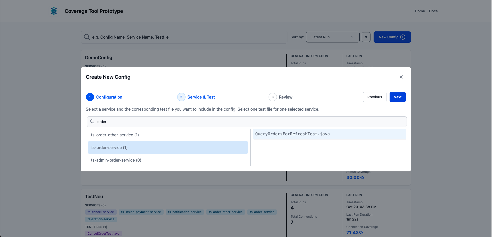
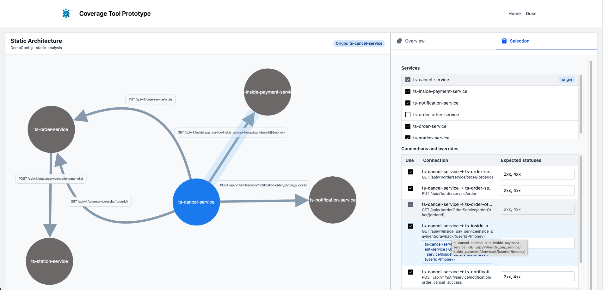
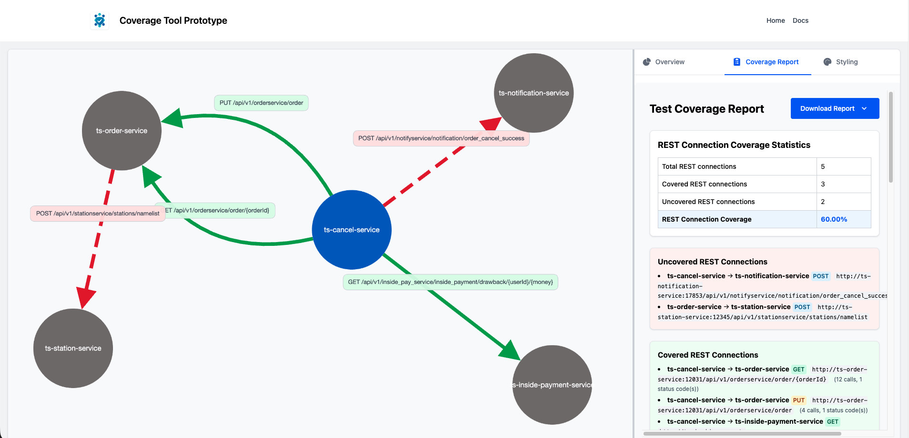

# Reachability Aware Microservice Coverage

A tool for measuring how thoroughly **integration tests** exercise the interactions between the services of a
microservice system.

It combines a **static analysis** of the services' source code (which interactions are possible) with **distributed
traces** recorded while the tests run (which interactions actually happened), and reports coverage per connection
between two services and for the system as a whole.

## How it works

1. **Static analysis** – starting from one root service (all of its endpoints, or the
   [entry endpoints](#coverage-config-file) the tests call), the source code is analysed recursively: endpoints, outgoing
   REST calls (`RestTemplate.exchange`), the connections between services and what the callers can put into their
   requests. Additionally, the OpenAPI specs of the relevant services are used to generate possible value partitions.
2. **Test execution** – the selected Java integration tests run with the OpenTelemetry / Hypertrace agent attached;
   the services under test run in Docker containers with the same agent.
3. **Trace collection** – the spans of the test run are fetched from Jaeger.
4. **Evaluation** – static analysis and traces are matched per connection and the coverage metrics are computed.
5. **Reports** – the results are written as text, Markdown and JSON and can be explored in the web UI.

## Coverage metrics

All metrics are computed per **connection** (calling service → called endpoint) and aggregated over the system. Each
metric refines the previous one: connection coverage looks at all reachable connections, the other metrics only at the
connections the tests actually called, value partition coverage only at the request elements that were sent with a
value, response field coverage only at the responses whose status codes were actually returned, and response value
partition coverage only at the response fields that were returned with a value. A gap is therefore reported once, at
the level where it occurs.

### 1. REST Connection Coverage

The share of the reachable connections (found by the static analysis) that the tests called at least once. The report
lists the covered and the uncovered connections.

### 2. Request Element Coverage

How many of the **request elements** (path parameters and request body fields, including nested fields) that the caller
*can* send were actually sent with a value. Elements the caller never sends (found by the static analysis) do not count
against the tests; spec fields and caller fields that do not match are reported as interface mismatches.

→ Details: [coverage/docs/request-element-coverage.md](coverage/docs/request-element-coverage.md)

### 3. Request Value Partition Coverage

How many **classes of values** of the sent request elements were exercised: e.g. the boundaries and the interior of a
range, every enum value, empty and non-empty strings and lists, no value at all. The partitions are derived from the
OpenAPI spec (with type-based fallbacks when the spec has no constraints); values the spec does not allow are listed
but not counted. The static analysis excludes partitions the caller can never produce (constants, primitive fields).

→ Details: [coverage/docs/request-value-partition-coverage.md](coverage/docs/request-value-partition-coverage.md)

### 4. Status Code Class Coverage

How many of the expected response classes each called connection returned during the tests. By default the expected
classes are **2xx** (success) and **4xx** (client error): a connection that only ever answered 200 is covered to 50 %.
Server errors (5xx) are reported separately and do not count, since they point to implementation or infrastructure
problems rather than to test quality. The value is reported over all connections and over the called connections
only, with the lowest and median connection value; the report lists every called connection that missed an expected
code or class, with the codes it did return. The expected classes or codes can be changed globally and per connection in a
[coverage config file](#coverage-config-file). Systems that report their outcome in the response body (always HTTP
200, e.g. `"status": 0` on failure) can expect body outcomes instead, e.g. `status=1` and `status=0`.

→ Details: [coverage/docs/status-code-class-coverage.md](coverage/docs/status-code-class-coverage.md)


### 5. Response Field Coverage

How many of the **response fields** documented in the called service's OpenAPI spec were returned with a value. Only
the responses whose status code was returned at least once and is expected for the connection count (a status code
that never occurred is already a gap of status code class coverage). Each status code has its own fields (e.g.
`201:reservationId`, `409:message`); fields returned but not documented are listed but not counted.

→ Details: [coverage/docs/response-field-coverage.md](coverage/docs/response-field-coverage.md)

### 6. Response Value Partition Coverage

How many **classes of values** of the returned response fields the called services returned during the tests: e.g.
every enum value, the boundaries of a range, an empty and a non-empty list, an optional field without a value. The
partitions come from the response schemas of the called services, with the same rules as for requests
(e.g. `200:currency#enum=CHF`); values the schema does not allow are listed as *returned outside the spec* but not
counted. Every partition of a returned field counts (there is no analysis of the callee's code yet).

→ Details: [coverage/docs/response-value-partition-coverage.md](coverage/docs/response-value-partition-coverage.md)

### Additional check: Request Body Schema Validation

Not a coverage metric: the recorded request bodies of the called connections are validated against the request body
schema of the OpenAPI spec, to find missing or malformed fields. `null` in an optional field counts as absent (Java
callers with Jackson write unset fields as `null`); `null` in a required field is only valid if the field is nullable.
The check covers structure and types; values outside the constraints are reported by the value partition coverage.

## Prerequisites

- Java 17 (JDK) and Maven 3.9+
- Docker with Docker Compose (Jaeger and the services under test run in containers)
- Node.js 18+ and pnpm 8+ (only for the web UI)
- The microservice system under test with its integration tests and Docker images built on the Hypertrace base image
  (see `tracing/hypertrace`)
- Optional but recommended: the OpenAPI specs of its services (Swagger 2.0, OpenAPI 3.0 or 3.1; JSON or YAML) in one
  folder, see [OpenAPI specs](#openapi-specs)

## Setup

Copy `.env.example` to `.env` in the repository root and adjust the paths:

```bash
cp .env.example .env
```

| Variable | Meaning |
|---|---|
| `MICROSERVICES_ROOT` | Folder that contains the service folders of the system under test |
| `MICROSERVICES_PREFIX` | Prefix of the service folders (web UI), e.g. `ts-` |
| `HYPERTRACE_AGENT_PATH` | Hypertrace agent jar attached to the test JVM |
| `HYPERTRACE_CONFIG_PATH` | Hypertrace configuration of the test JVM |
| `TOOL_ROOT` | Root of this repository (web UI) |

- `.env` is the only configuration file: `build.sh`, the coverage tool and the web UI all read it; it is not committed.
  To switch between systems, comment one `MICROSERVICES_ROOT` / `MICROSERVICES_PREFIX` block in and the other out
  (whole-line `#` comments only).
- Variables set in the terminal take precedence over `.env`. After sourcing `.env` in a terminal
  (`set -a; source .env; set +a`, as in the example below), source it again after every change, or open a new
  terminal; otherwise the old values are used.
- Always start the tool from the repository root (as the scripts do); it reads `.env` from the current folder.
- `test-config.yaml` is the Hypertrace configuration for the test JVM (reports to `localhost:4317`, captures request
  and response bodies). The containers use the built-in `hypertrace-config.yaml` (reports to `host.docker.internal`).
- Request and response bodies must be captured (`dataCapture.httpBody`) for the request element and value partition
  coverage; both configurations do this.

## Build

```bash
./build.sh
```

The script builds the Hypertrace base image, the Docker images of the microservice system (`build_images.sh` in
`MICROSERVICES_ROOT`), the coverage tool (`coverage/`) and installs the frontend dependencies. Run it again after
changes to the microservices; changes to the coverage tool are rebuilt by `run-coverage.sh` automatically.

## Running a coverage analysis
All run commands from the tool demonstration can be found here: [tool-demonstration/ReadMe.md](tool-demonstration/ReadMe.md)

From the repository root:

```bash
./run-coverage.sh <root-service-folder> [<test-file.java>[#methodName] ...] \
    [--config <name>] [--config-file <path>] [--openapi-dir <path>] [--static] [--force-reanalyze]
```

| Argument | Meaning |
|---|---|
| `<root-service-folder>` | The service the analysis starts from (exactly one); the services it calls are found recursively |
| `<test-file.java>` / `<test-file.java>#method` | Integration test class (or a single test method) to run; several are possible |
| `--config <name>` | Stores the run under `storage/runs/<name>/<timestamp>/` (otherwise `coverage-results/<timestamp>/`) and uses `storage/configs/<name>.json` as coverage config file, if it exists |
| `--config-file <path>` | Coverage config file to use instead of `storage/configs/<name>.json` |
| `--openapi-dir <path>` | Folder with the OpenAPI specs; default `./slim_open_api` (the TrainTicket specs) |
| `--static` | Only the static analysis (no tests, no traces) |
| `--force-reanalyze` | Ignores the static analysis cache (`storage/cache`) |

The script starts Jaeger if it is not running (it keeps running afterwards; stop it with `docker compose stop jaeger`),
rebuilds the coverage tool, runs the tests and writes the reports.

Example (TrainTicket, order cancellation):

```bash
set -a; source .env; set +a
./run-coverage.sh $MICROSERVICES_ROOT/ts-cancel-service \
    $MICROSERVICES_ROOT/ts-cancel-service/src/test/java/cancel/integration/get/CancelOrderTest.java \
    --config CancelConfig
```

Integration tests that start many containers need a machine with enough memory for Docker; if a container does not
start in time, all tests of the class fail. The tool prints a summary of the JUnit report for every test class with
failed or errored tests, and stops without a coverage report if every test errored (no test body ran).

### OpenAPI specs

The specs of all services are expected in one folder (`--openapi-dir`). The spec of a service is found by the service
name (the name of its folder), in this order: `<service>.json`, `<service>-openapi.json`, `<service>-slim.json`,
`<service>/openapi.json`, each also as `.yaml` / `.yml`. Services without a spec are listed in the log; their
request elements then come from the caller's DTO only (marked as "body spec missing"), and the value partitions are
only type-based.

### Coverage config file

The coverage config file sets the expected status codes and, optionally, the entry endpoints of the tests. It is
resolved in this order: `--config-file <path>`,
then `storage/configs/<name>.json` for `--config <name>` (the file the web UI saves), otherwise the defaults (2xx and
4xx). The log says which file was used, and the file is copied into the run folder.

```json
{
  "configName": "CancelConfig",
  "globalExpectedStatusCodes": ["2xx", "4xx"],
  "connectionOverrides": [
    { "sourceService": "ts-cancel-service", "destinationService": "ts-order-service",
      "method": "GET", "path": "/api/v1/orderservice/order/{orderId}",
      "expectedStatusCodes": ["200", "404"] }
  ]
}
```

- Entries are status classes (`4xx`), single codes (`404`) or **body outcomes** (`status=0`); anything else is
  reported as a warning. An unknown field or invalid JSON stops the run before the tests start, with the field and its
  position in the message.
- Body outcomes are for systems that report the outcome of a call in the response body instead of the HTTP status
  code. TrainTicket, for example, always answers HTTP 200 with `"status": 1` on success and `"status": 0` on failure,
  so its config uses `["status=1", "status=0"]`. An entry `<field>=<value>` is covered if a recorded response body of
  the connection has that value in that field (nested fields with dots, e.g. `result.code=OK`; numbers are compared
  by value). It needs the recorded response bodies, so it cannot be covered for a mocked callee. HTTP entries and body
  outcomes can be mixed. Response field and response value partition coverage count only responses of a relevant
  class (e.g. not a `"status": 2` response when `status=1` and `status=0` are expected) and group them by HTTP status
  code.
- An override applies to the connections it matches; `sourceService`, `destinationService`, `method` and `path` can be
  left out to match any value; other field names stop the run with a message. `path` is the endpoint template or the
  called URL (or its path). The first matching override with expected codes wins; otherwise
  `globalExpectedStatusCodes` applies.
- **Excluded connections** (optional): the static analysis can report a connection as reachable that is not,
  e.g. because it depends on runtime data or configuration it cannot see. An override with `"reachable": false`
  removes such a connection from the coverage:

  ```json
  "connectionOverrides": [
    { "sourceService": "ts-cancel-service", "destinationService": "ts-order-service",
      "method": "PUT", "path": "/api/v1/orderservice/order",
      "reachable": false, "reason": "only called for orders of the old booking flow" }
  ]
  ```

  An exclusion names exactly one connection: `sourceService`, `destinationService`, `method` and `path` (endpoint
  template or called URL) are required, `expectedStatusCodes` is not allowed, `reason` is optional. Exclusions apply
  regardless of their position in the list and are ignored for the expected status codes. They are applied when the
  coverage is computed, so the static analysis result (`microservice-system.json`, `--static`) stays complete, and a
  changed exclusion takes effect in the next run without a new static analysis. Connections that are reachable only
  through an excluded connection are excluded as well; a connection that is still reachable on another path stays.
  Excluded connections are not part of any coverage value; the report lists them (with the reason, or the excluded
  connection they depend on). Warnings: an exclusion that matches no reachable connection (typo), and an excluded
  connection that the tests executed nevertheless (the exclusion is probably wrong; it stays excluded).
- **Entry endpoints** (optional): by default, every endpoint of the root service is an entry point of the
  reachability analysis, so the reachable connections include those of endpoints the tests never call. If a test only
  calls some endpoints of the root service, list them in its entry of `tests` (the list the web UI writes):

  ```json
  "tests": [
    {
      "path": "plan/integration/post/SearchCheapestResultTest2.java",
      "fileName": "SearchCheapestResultTest2.java",
      "serviceName": "ts-route-plan-service",
      "entryEndpoints": [
        { "method": "POST", "path": "/api/v1/routeplanservice/routePlan/cheapestRoute" }
      ]
    }
  ]
  ```

  `path` of an entry endpoint is the endpoint's path template or a concrete path it matches; `method` can be left out
  (any method). A run has one coverage space: its entry endpoints are the union of the entry endpoints of the tests it
  executes (the `tests` entries whose `<serviceName>/src/test/java/<path>` matches a test file of the command line;
  with `--static` and no test files, all `tests` entries). If an executed test has no `entryEndpoints`, or a test file
  is not listed in `tests`, every endpoint of the root service stays an entry point (the log says why). Entry
  endpoints of a test of another service than the root service (the first service folder), an entry that matches no
  endpoint of the root service, and a top-level `entryEndpoints` list stop the run before the tests start. The log
  and `microservice-system.json` (`communicationPathResult.entryEndpoints`) show the entry endpoints used.
- `services` is ignored by the coverage tool; of `tests`, only `entryEndpoints` is used. Saving a config with the
  same name in the web UI overwrites the file, including manually added status codes and entry endpoints.

## Web UI

```bash
cd frontend
pnpm install   # done by build.sh
pnpm dev
```

The UI (usually at `http://localhost:5173`) reads the root `.env`, lists the runs in `storage/runs`, lets you select
tests and services, starts `run-coverage.sh` and shows the reports and the connection graph.

## WebUI examples

The web UI follows the same flow as a coverage run: create a new configuration, inspect the static analysis of the
service graph, and then open the generated report to review the measured coverage. The first screen is used to define
or select a run configuration, the static analysis view shows the discovered services and connections, and the report
view presents the detailed coverage metrics and connection-level results.

New configuration screen: the user creates or selects a run configuration before starting the analysis.



Static analysis view for a simple case: the discovered service graph shows which services are reachable and how they call each other. The user can 
add/remove services and connections, as well as edit the expected status codes for each connection. The graph is interactive and can be zoomed and panned.



Report view: after the analysis, the UI shows the connection coverage and detailed results for each service interaction.



## Output

Each run creates a folder (`storage/runs/<config>/<timestamp>/`) with:

| File | Content |
|---|---|
| `coverage-report.txt` / `.md` | Human-readable report, ordered as the metrics are introduced: request coverage metrics (connection, request element, request value partition coverage, request body schema validation), then response coverage metrics (status code class, response field, response value partition coverage); the same order per connection, followed by the recorded bodies |
| `coverage-report.json` | All results in machine-readable form (used by the web UI) |
| `microservice-system.json` | Result of the static analysis: services, endpoints, connections and their request elements |
| `run-metadata.json` | Durations, the executed tests and the coverage config file used |
| `coverage-config.json` | Copy of the coverage config file used (if any) |
| `<service>/<test>/processed-spans.json`, `raw-spans.txt` | The recorded spans of each test class |
| `TEST-*.xml` (per test class) | JUnit reports |

With `--static`, only `storage/runs/<config>/static-analysis.json` (graph view) and `microservice-system.json` (services with their endpoints and connections) are written.

## Repository structure

| Folder | Content |
|---|---|
| `coverage/` | The coverage tool (Java): static analysis, test runner, trace client, evaluation, reports; detailed metric documentation in `coverage/docs/` |
| `frontend/` | Web UI (SvelteKit) |
| `tracing/` | Hypertrace / OpenTelemetry agents, configurations and base images |
| `slim_open_api/` | OpenAPI specs of the TrainTicket services (the default `--openapi-dir`) |
| `evaluation/` | Evaluation data of the thesis |
| `storage/` | Runs and the static analysis cache (created at runtime) |

## Limitations of this current version

- The tests of the system under test run in their own JVM with the JUnit console launcher 1.10 and the system's own
  dependencies; the tool's libraries are not on that classpath. A system whose JUnit version is incompatible with
  launcher 1.10 is not supported yet (future work: run the tests through the system's own Maven Surefire instead).
- Only Java services with Spring endpoints and `RestTemplate.exchange` calls are analysed; communication other than
  synchronous REST is not covered.
- Request elements are path parameters and request body fields; query parameters and headers are not covered yet.
- Request element and value partition coverage need captured request bodies; calls to mocked services (e.g. WireMock)
  have no server span and are reported as not applicable.
- The quality of the value partitions depends on the OpenAPI spec: without constraints only type-based partitions are
  available.
- Response field coverage requires response schemas in the OpenAPI specs; specs that only describe responses as an
  untyped `HttpEntity` (e.g. springfox output for TrainTicket) make it not applicable. Interface mismatches between
  response schemas and the caller's response classes are not reported yet.
- Response value partition coverage counts every partition of a returned field: partitions the callee can never
  produce (e.g. a negative price when the spec declares no `minimum`) are not excluded, since the callee's code is not
  analysed yet.

The detailed limitations of each metric are listed in its document in `coverage/docs/`.
